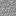

<div align="center">



# Grassblocks Cracker

Find candidate Minecraft world coordinates from grass texture rotations in a screenshot.

[Open the app](https://grass.kjt.lol) · [Build locally](#build-locally) · [Native solvers](#native-solvers) · [How it works](#how-it-works)

[](LICENSE)


</div>

Grass blocks have coordinate-dependent texture rotations. This project detects visible grass faces, reconstructs their relative positions and rotations, then searches a bounded region for origins that reproduce that pattern. It finds **formation origins, not world seeds**; an origin is not necessarily the player's position.

Everything runs on your device. The [live site](https://grass.kjt.lol) serves static files; screenshots, formations and searches are not sent to a compute server. For larger searches, export the same formation to the standalone CUDA or Metal solver.

## Try it

Open **[grass.kjt.lol](https://grass.kjt.lol)** in a browser with WebAssembly SIMD support. WebGPU is used when available, with a WASM CPU fallback.

1. Open, drop or paste a screenshot with visible vanilla grass-top textures.
2. In **Auto**, choose an X/Z range and press **START**. Detection runs first, then the solver searches the detected formation.
3. Read candidate coordinates and facing directions in the results. Each result has a copyable `/tp` command.

The range chips search inclusive X/Z bounds of ±2,000, ±10,000 or ±100,000, with **±10,000** selected initially. **Search options** controls the Y bounds, north interpretations, result limit and stop-at-first behavior.

If automatic detection struggles, switch to **Manual** and draw the four corners of one grass-top tile clockwise from its top-left corner. START grows a formation from that quad. The formation table also lets you edit relative positions, per-block heights and rotations, or exclude questionable faces. In Manual mode, START can search existing rows without a drawn quad. Use **Export formation.txt** to keep the observations or run them natively.

> [!TIP]
> **Hill example (fixture)** loads a saved, calibrated formation. It is a regression example, not evidence that automatic detection recovered those observations. Uploading a screenshot and using Auto runs the general detector.

## How it works

**Pixels, then geometry.** Local VLFeat SIFT features and OpenCV homographies propose grass-tile corners. The detector fits a block lattice and verifies faces against the bundled vanilla reference texture using pixel correlation. Automatic trials combine compatible observations; manual corners provide a starting tile when feature matching fails.

**A formation, not just a flat grid.** Each accepted face records relative `x y z`, texture rotation and whether it is a side face. Heights are individual offsets, so stepped terrain can be represented. Automatic image detection targets grass tops; the formation format and solvers also accept side observations.

**An exact integer search.** The solvers evaluate the modern vanilla block-coordinate hash and Java Random rotation path at candidate origins, under the selected north interpretations. Integer wrapping and the required 64-bit arithmetic are preserved, including in WGSL through paired 32-bit values.

| Backend | What runs there |
| --- | --- |
| **WebGPU** | Browser GPU search, plus experimental GPU correlation/ECC refinement for detection. Automatic GPU detection still depends on native WASM SIFT/homography proposals; it is not entirely GPU-based. |
| **WASM** | OpenCV, VLFeat and SIMD image processing in a native detector module; SIMD CPU search in browser workers. Used when WebGPU is unavailable or fails. |
| **CUDA** | Standalone C++/CUDA coordinate solver for NVIDIA GPUs. Reads exported formations, not screenshots. |
| **Metal** | Standalone Objective-C++/Metal coordinate solver on macOS. Reads the same formations. |

The browser selects its detection and search backends automatically. WebGPU uses the browser's graphics API, not the native CUDA program. Backend selection, device support and performance depend on the browser and driver.

> [!IMPORTANT]
> A match is a candidate within the bounds actually searched, not proof of a unique location across the world. Wrong rotations, heights or geometry can remove the real answer. Resource packs, occlusion and renderer changes can break detection or change rotation behavior. There is no separate legacy/Sodium-specific hash selector. A cancelled or result-limited run is not a complete search.

## Build locally

Clone the repository first. Run the Docker commands from its root.

```sh
git clone https://github.com/koboshchan/grassblocks-cracker.git
cd grassblocks-cracker
```

### Docker

The self-contained build compiles the detector, SIMD CPU solver, validated WebGPU solver shader and TypeScript app from source. The final image serves static files with nginx; it does not run searches on the server or build the native CUDA/Metal tools.

```sh
docker build -f web/Dockerfile -t grassblocks-cracker .
docker run --rm -p 127.0.0.1:18643:80 grassblocks-cracker
```

Open **http://localhost:18643**. The image supplies isolation headers, WebAssembly MIME types and a `/healthz` endpoint.

### Without Docker

Use a POSIX shell, Node.js 24, Python 3, Clang/LLD with `wasm32` support, and Emscripten with CMake, Ninja, curl, tar and `sha256sum`. The Dockerfile pins Emscripten 3.1.64. The initial native detector build downloads and builds OpenCV, so it needs network access and build space.

```sh
cd web
npm ci

# Build the complete OpenCV + VLFeat detector and its JS loader.
sh wasm/build-pipeline.sh

# Typecheck, build the standalone SIMD modules and bundle the app.
npm run build

python3 serve.py --port 18643
```

Open **http://localhost:18643**. Build output is in `web/dist/`. Do not skip the pipeline step on a fresh checkout: `npm run build` builds the standalone WASM modules but expects the generated `grass-pipeline.js` and `grass-pipeline.wasm` detector assets to exist. After changing detector C/C++ sources, relink them with `sh wasm/build-pipeline.sh link` before rebuilding the app.

For the separate shader-validation step, install the Dockerfile's pinned `naga-cli` 30.0.1 and run `npm run build:webgpu` before `npm run build`.

> [!NOTE]
> Self-host `dist/` over HTTPS or localhost, not `file://`. Preserve `application/wasm` for WASM files and the supplied COOP/COEP headers for cross-origin isolation. The included server and nginx config set these headers. The Python server binds to all interfaces and is intended for local development.

## Native solvers

Export `formation.txt` from the browser. Keep each solver source beside its `solver_common.h`; both are available in the repository. There is no separate native screenshot detector.

### CUDA

Requires a CUDA toolkit, an NVIDIA GPU and a host C++ compiler supported by that toolkit. From the repository root, build for your GPU's compute capability; `sm_89` below is an Ada example.

```sh
cd cuda
nvcc -std=c++17 -O3 -arch=sm_89 grass_solver.cu -o grass_solver
./grass_solver --formation formation.txt --north all -10000 10000 -64 319 -10000 10000
```

Place the exported file in the current directory or pass its location. On Windows, build from an x64 Visual Studio developer command prompt and use `grass_solver.exe`. See the [CUDA notes](cuda/README.md) for toolchain and tuning details.

### Metal

Requires macOS, a Metal-capable GPU and Xcode command-line tools.

```sh
cd metal
clang++ -std=c++17 -O3 -fobjc-arc grass_solver.mm \
  -framework Foundation -framework Metal -o grass_solver
./grass_solver --formation formation.txt --north all -10000 10000 -64 319 -10000 10000
```

Place the export in this directory or pass its location. See the [Metal notes](metal/README.md) for cache controls and native regression tests.

For both solvers, the six positional bounds are **`xmin xmax ymin ymax zmin zmax`**, all inclusive. `--north` accepts `0`, `1`, `2`, `3` or `all`. Runtime tuning defaults to `--autotune auto`; `force` remeasures and `off` skips tuning.

Stdout contains one `x y z north` candidate per line. Progress and timing go to stderr, so `> matches.txt` captures just the results. Check the exit status before treating the file as a complete search.

### Formation format

The first non-comment line is the observation count, followed by that many rows of `x y z rotation is_side`.

```text
# Illustrative observations, not a calibrated location.
3
0 0 0 2 0
1 0 0 1 0
0 1 1 0 0
```

Coordinates are signed relative offsets. Top rotations are `0..3`; side rotations are `0..1`. `is_side` is `0` or `1`. Blank lines, `#` comments and trailing metadata are accepted by the native readers.

Current browser exports use the raw north-0 frame. Search them with `--north all` when orientation is unknown. The transforms are `(x,z)`, `(-z,x)`, `(-x,-z)` and `(z,-x)`; each quarter-turn adds one to the texture rotation modulo four, or modulo two for sides. Already world-oriented legacy exports must use `--north 0` to avoid rotating them twice.

## Development checks

From `web/`, after `npm ci`:

```sh
npm run typecheck
node --import tsx --test tests/*.test.ts
```

These tests cover routing, worker transport, detection orchestration, ECC batching and the START flow. They do not replace real-browser GPU validation or native hardware tests.

After compiling either native solver, run `python3 test_solver.py ./grass_solver` from its directory. The bundled `fixtures/hill22.txt` is a small calibrated regression:

```sh
./grass_solver --formation fixtures/hill22.txt --north all \
  --autotune off 3535 3541 88 92 -457 -451
```

Its expected sole candidate is `3538 90 -454 0`. See [web/tests/RESEARCH.md](web/tests/RESEARCH.md) for hash arithmetic and oracle coverage.

## Project map

| Path | Contents |
| --- | --- |
| [web/](web/) | Plain TypeScript interface, workers, browser search and static hosting |
| [web/src/detect/](web/src/detect/) | Detector routing and experimental WebGPU processing |
| [web/wasm/](web/wasm/) | Native OpenCV/VLFeat detector, geometry and build scripts |
| [cuda/](cuda/) | CUDA solver, shared parser, fixtures and oracle tests |
| [metal/](metal/) | Metal solver, shared parser, fixtures and oracle tests |

Original project code is [MIT-licensed](LICENSE). OpenCV and VLFeat retain their own licenses; see [third-party notices](web/public/THIRD-PARTY-NOTICES.txt) and [vendor license texts](web/public/vendor/). The reference grass texture is a Minecraft asset, not MIT-licensed project artwork. This project is not affiliated with Mojang or Microsoft, and its license does not license Minecraft assets or the upstream TextureRotations project.
